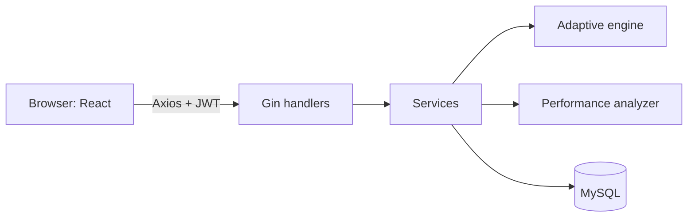

# AdaptIQ — Adaptive Technical Assessment Platform

A full-stack platform where candidates take timed technical interviews whose **difficulty adapts after every answer**, and admins manage the question bank and review analytics.

> **Stack:** Go (Gin, GORM) · MySQL 8 · React (Vite) · JWT · Recharts · Docker
> The adaptive engine is **rule-based** (not machine learning). See [Future improvements](docs/future-improvements.md) for planned AI features; none are implemented.

## Features

**Candidate**

- Register / log in (JWT), role-protected routes
- Take adaptive MCQ interviews with a server-validated timer
- Resume an interview after a page refresh
- Per-interview report: score, accuracy, topic and difficulty breakdown, strong/weak topics, recommendations
- Dashboard with accuracy trend and topic performance

**Admin**

- Question bank CRUD with search, filters (topic, difficulty, status) and pagination
- Assessment management (question count, duration, whether explanations are shown)
- Candidate list with search, sorting, pagination and report history
- Platform analytics from real database aggregates

**Engineering**

- Layered backend: handler → service → GORM → MySQL
- Row-level locking and transactions on answer submission
- `UNIQUE(session_id, question_id)` prevents duplicate questions at the database level
- Correct answers never leave the server before submission
- Consistent `{success, message, data}` API envelope and no leaked stack traces
- OpenAPI docs at `/swagger`

## Architecture



More in [docs/architecture.md](docs/architecture.md).

## Quick start

```bash
# 1. Database
mysql -u root -p < database/schema.sql

# 2. Backend
cd backend && cp .env.example .env      # set DB_PASSWORD and JWT_SECRET
go run ./cmd/server                     # http://localhost:8080

# 3. Frontend
cd frontend && cp .env.example .env && npm install && npm run dev   # http://localhost:5173
```

Or with Docker: `cp .env.example .env && docker compose up --build`.
Full instructions: [docs/setup.md](docs/setup.md).


These are for local demos only. Set `ADMIN_PASSWORD` / `CANDIDATE_PASSWORD` to override them before the first run.

## Environment variables

| Variable                                              | Where    | Purpose                          |
| ----------------------------------------------------- | -------- | -------------------------------- |
| `DB_HOST` `DB_PORT` `DB_USER` `DB_PASSWORD` `DB_NAME` | backend  | MySQL connection                 |
| `JWT_SECRET`                                          | backend  | Signing key (required)           |
| `JWT_EXPIRY_HOURS`                                    | backend  | Token lifetime                   |
| `ALLOWED_ORIGIN`                                      | backend  | CORS origin of the frontend      |
| `AUTO_MIGRATE`                                        | backend  | `false` when using `schema.sql`  |
| `ADMIN_PASSWORD` `CANDIDATE_PASSWORD`                 | backend  | Optional seed password overrides |
| `VITE_API_URL`                                        | frontend | Backend base URL                 |

## Database

Nine tables: `users`, `topics`, `questions`, `question_options`, `assessments`, `interview_sessions`, `session_questions`, `responses`, `interview_reports`. See [docs/database.md](docs/database.md) for the ER diagram.

## API

Interactive docs at `http://localhost:8080/swagger`. Summary in [docs/api.md](docs/api.md).

## Testing

```bash
cd backend
go test ./internal/service/      # unit tests; integration tests are skipped without TEST_DB_DSN
```

See [docs/setup.md](docs/setup.md#tests) for running the MySQL integration tests.

## Screenshots

Add your own screenshots to `screenshots/` and link them here (login, candidate dashboard, interview screen, report, admin overview, question bank).

## Known limitations

- Next-question selection uses difficulty only; topic accuracy is used in reports, not in selection.
- JWT is kept in `localStorage` (XSS-exposed). An httpOnly cookie would be safer.
- MCQ only; the schema has a `question_type` column so other types can be added.
- Per-question time limits are stored but not enforced; only the overall timer is.
- Deployment has not been tested on any cloud provider.

## Future improvements

See [docs/future-improvements.md](docs/future-improvements.md).
