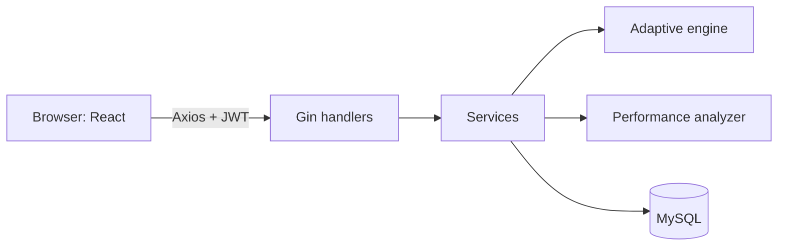

# AdaptIQ — Adaptive Technical Assessment Platform

A full-stack platform where candidates take timed technical interviews whose **difficulty adapts after every answer**, and admins manage the question bank and review analytics.

> **Stack:** Go (Gin, GORM) · MySQL 8 · React (Vite) · JWT · Recharts · Docker  
> The adaptive engine is **rule-based** (not machine learning). See [Future improvements](docs/future-improvements.md) for planned AI features; none are implemented.

## Features

### Candidate

- Register / log in (JWT), role-protected routes
- Take adaptive MCQ interviews with a server-validated timer
- Resume an interview after a page refresh
- Per-interview report: score, accuracy, topic and difficulty breakdown, strong/weak topics, recommendations
- Dashboard with accuracy trend and topic performance

### Admin

- Question bank CRUD with search, filters (topic, difficulty, status) and pagination
- Assessment management (question count, duration, whether explanations are shown)
- Candidate list with search, sorting, pagination and report history
- Platform analytics from real database aggregates

### Engineering

- Layered backend: handler → service → GORM → MySQL
- Row-level locking and transactions on answer submission
- `UNIQUE(session_id, question_id)` prevents duplicate questions at the database level
- Correct answers never leave the server before submission
- Consistent `{success, message, data}` API envelope and no leaked stack traces
- OpenAPI docs at `/swagger`
- Versioned database migrations managed by the Go backend
- Docker-based development environment with separate frontend, backend and database services

## Architecture



More in [docs/architecture.md](docs/architecture.md).

## Quick start

### Option 1: Run locally

**Prerequisites:** Go, Node.js, npm and MySQL 8.0.

**1. Create the database**

```bash
mysql -u root -p -e "CREATE DATABASE adaptive_assessment CHARACTER SET utf8mb4;"
```

**2. Configure and start the backend**

```bash
cd backend
cp .env.example .env
```

Configure your `.env` file with your MySQL credentials and JWT secret. Enable migrations:

```env
RUN_MIGRATIONS=true
```

Then run:

```bash
go mod tidy
go run ./cmd/server
```

The backend applies pending database migrations during startup and runs the configured seed process.

Backend: [http://localhost:8080](http://localhost:8080)

**3. Configure and start the frontend**

Open another terminal:

```bash
cd frontend
cp .env.example .env
npm install
npm run dev
```

Frontend: [http://localhost:5173](http://localhost:5173)

### Option 2: Run with Docker

From the project root:

```bash
cp .env.example .env
docker compose up -d --build
```

Docker Compose starts MySQL, waits for its healthcheck, and then starts the backend and frontend.

Frontend: [http://localhost:5173](http://localhost:5173)

Backend: [http://localhost:8080](http://localhost:8080)

To check running services:

```bash
docker compose ps
```

To view backend logs:

```bash
docker compose logs --tail=100 backend
```

To stop the services:

```bash
docker compose down
```

**Note:** `docker compose down -v` deletes the database volume and all stored database data. Use it only when you intentionally want to reset the Docker database.

Full instructions: [docs/setup.md](docs/setup.md).

These are for local demos only. Set `ADMIN_PASSWORD` / `CANDIDATE_PASSWORD` to override the default seed passwords before the first seed run.

## Environment variables

| Variable             | Where    | Purpose                                            |
| -------------------- | -------- | -------------------------------------------------- |
| `DB_HOST`            | Backend  | MySQL hostname                                     |
| `DB_PORT`            | Backend  | MySQL port                                         |
| `DB_USER`            | Backend  | MySQL username                                     |
| `DB_PASSWORD`        | Backend  | MySQL password                                     |
| `DB_NAME`            | Backend  | Database name                                      |
| `JWT_SECRET`         | Backend  | Signing key (required)                             |
| `JWT_EXPIRY_HOURS`   | Backend  | Token lifetime                                     |
| `ALLOWED_ORIGIN`     | Backend  | CORS origin of the frontend                        |
| `RUN_MIGRATIONS`     | Backend  | Set to `true` to apply pending database migrations |
| `ADMIN_PASSWORD`     | Backend  | Optional admin seed password override              |
| `CANDIDATE_PASSWORD` | Backend  | Optional candidate seed password override          |
| `CODING_EXECUTOR`    | Backend  | Coding execution configuration                     |
| `VITE_API_URL`       | Frontend | Backend API base URL                               |

Refer to the `.env.example` files for the complete configuration.

## Database

The application uses MySQL 8 with GORM-managed database migrations. The schema includes tables for users, topics, questions, assessments, interview sessions, responses, reports, and coding assessments.

See [docs/database.md](docs/database.md) for the database structure and ER diagram.

## API

Interactive API documentation: [http://localhost:8080/swagger](http://localhost:8080/swagger).

Summary in [docs/api.md](docs/api.md).

## Testing

```bash
cd backend
go test ./internal/service/
```

Unit tests are included. Integration tests are skipped without `TEST_DB_DSN`.

See [docs/setup.md](docs/setup.md#tests) for running the MySQL integration tests.

## Screenshots

Add your own screenshots to `screenshots/` and link them here:

- Login
- Candidate dashboard
- Interview screen
- Report
- Admin overview
- Question bank

## Known limitations

- Next-question selection uses difficulty only; topic accuracy is used in reports, not in selection.
- JWT is kept in `localStorage` (XSS-exposed). An httpOnly cookie would be safer.
- MCQ only; the schema has a `question_type` column so other types can be added.
- Per-question time limits are stored but not enforced; only the overall timer is.
- Deployment has not been tested on any cloud provider.

## Future improvements

See [docs/future-improvements.md](docs/future-improvements.md).
