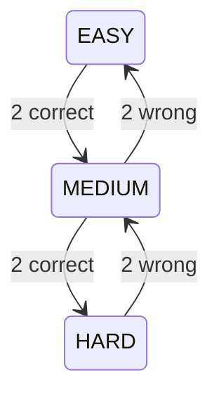

# Adaptive algorithm

Code: `backend/internal/service/adaptive.go` (pure logic, unit-tested) and `interview.go` (selection).

## State per session

`current_difficulty` (starts MEDIUM), `consecutive_correct`, `consecutive_wrong`.

## Rules (after each answer)

- Correct: `consecutive_correct++`, wrong streak reset. At **2 in a row** → one level harder, streak reset.
- Wrong: `consecutive_wrong++`, correct streak reset. At **2 in a row** → one level easier, streak reset.
- Difficulty is clamped to EASY..HARD. Streaks reset after a change so the next change needs fresh evidence.

## Example trace

| Q   | Served at | Answer  | Streaks after | Next difficulty |
| --- | --------- | ------- | ------------- | --------------- |
| 1   | MEDIUM    | correct | cc=1          | MEDIUM          |
| 2   | MEDIUM    | correct | cc=2 → reset  | **HARD**        |
| 3   | HARD      | wrong   | cw=1          | HARD            |
| 4   | HARD      | wrong   | cw=2 → reset  | **MEDIUM**      |
| 5   | MEDIUM    | correct | cc=1          | MEDIUM          |

## Question selection

For the target difficulty, pick one random active MCQ **not already in this session** (`id NOT IN (SELECT question_id FROM session_questions WHERE session_id = ?)`). If none exists, fall back: HARD → MEDIUM → EASY, EASY → MEDIUM → HARD, MEDIUM → EASY → HARD. If the whole bank is exhausted the interview completes. `UNIQUE(session_id, question_id)` is the final guard against duplicates.

## Scoring

Correct answers earn difficulty-weighted points: Easy 1, Medium 2, Hard 3. Max score = sum of points of the questions that were served. Accuracy = correct / attempted.

## Reports

Strong topic: accuracy ≥ 75%. Weak topic: < 60%. Level: STRONG ≥ 75% overall, AVERAGE ≥ 50%, otherwise NEEDS_IMPROVEMENT. Recommendations are fixed advice text per weak topic (rule-based, not AI).

## Limitations

Selection ignores topic accuracy; the engine uses two-answer streaks rather than a statistical model (e.g. IRT). Both are listed as improvements.
