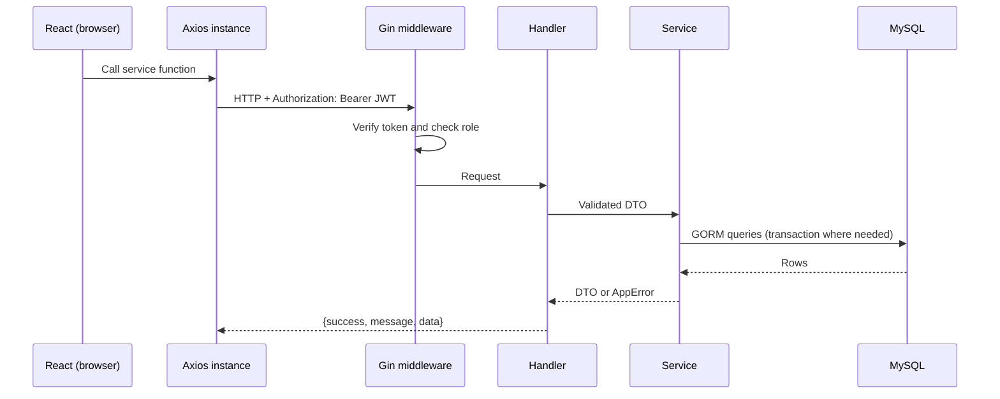

# Architecture

## Request Flow

## Backend Layers

| Layer             | Folder                                                            | Responsibility                                                    |
| ----------------- | ----------------------------------------------------------------- | ----------------------------------------------------------------- |
| Handler           | `internal/handler`                                                | Parse HTTP, bind/validate JSON, map errors to status codes        |
| Middleware        | `internal/middleware`                                             | JWT verification, role check                                      |
| Service           | `internal/service`                                                | Business logic, transactions                                      |
| Engine / analyzer | `internal/service/adaptive.go`, `internal/service/performance.go` | Pure logic with no DB dependency, unit-tested                     |
| Models            | `internal/models`                                                 | GORM entities                                                     |
| DTOs              | `internal/dto`                                                    | API contracts; candidate DTOs do not expose correct-answer fields |

## Frontend Layers

Pages → `services/` → one Axios instance (`api.js`) → backend.

The API URL lives only in `api.js`. The JWT is attached by a request interceptor. A 401 response clears the session and redirects to login.

## Database Architecture and Migrations

MySQL stores application data, including users, questions, assessments, interview sessions, responses, reports, and coding sessions.

The database schema is managed using versioned Go migrations instead of a manually imported `schema.sql` file.

At backend startup:

1. The backend connects to MySQL.
2. Pending migrations are checked and applied.
3. Applied migration versions are recorded in the `schema_migrations` table.
4. The configured seed process inserts demo users, questions, and assessments.
5. The API server starts accepting requests.

Migrations allow database schema changes to be tracked and applied consistently across local and Docker environments.

In Docker Compose, the backend waits for MySQL's healthcheck before starting.

## Security Model

- Passwords are hashed with bcrypt; login returns the same error for unknown email and wrong password.
- JWT (HS256 only) with role claim; middleware enforces roles on admin routes.
- Ownership checks in services: a candidate gets 404 for another candidate's report and 403 for their analytics.
- Public registration can only create candidates.
- Frontend route guards are UX only; enforcement is on the server.
- Candidate-facing DTOs never include `isCorrect`. The correct option is returned only if the assessment enables explanations.
- Code execution should use an isolated Docker judge with resource restrictions. Local execution is not suitable for publicly exposed deployments.

## Transactions and Concurrency

`Answer` runs in one transaction: lock the session row (`SELECT ... FOR UPDATE`), check status and expiry, store the response, update streaks and score, select and record the next question.

Double-clicks or parallel requests are serialized by the lock; a second submit finds the question already answered.

The report is generated after commit; `interview_reports.session_id` is UNIQUE so concurrent finishes cannot create two reports.

## Scaling Notes (Discussion, Not Implemented)

- Indexes: `idx_q_pick(active, difficulty, question_type)`, `idx_sess_candidate`, `idx_report_candidate`.
- Pagination everywhere lists can grow (questions, candidates, reports).
- `ORDER BY RAND()` is fine for a small bank; for a large one, pick a random ID range or pre-shuffle.
- Cache `/analytics/admin` (changes slowly); precompute topic stats per candidate.
- The Go server is stateless (JWT), so it scales horizontally behind a load balancer.

## Why These Choices

- **Go + Gin:** One static binary, low memory, simple concurrency.
- **REST + JSON:** Simple, cacheable, easy to document.
- **MySQL:** Relational data with integrity needs (foreign keys, unique constraints, transactions).
- **Normalization:** Options in their own table, topics separate, so a question's correct answer is never denormalized into responses.
