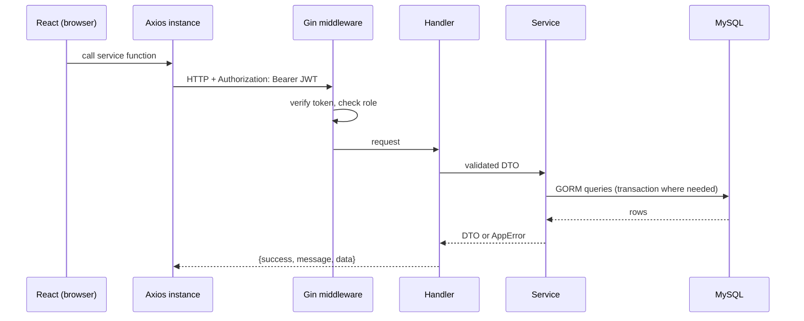

# Architecture

## Request flow

## Layers (backend)

| Layer             | Folder                                          | Responsibility                                                 |
| ----------------- | ----------------------------------------------- | -------------------------------------------------------------- |
| Handler           | `internal/handler`                              | Parse HTTP, bind/validate JSON, map errors to status codes     |
| Middleware        | `internal/middleware`                           | JWT verification, role check                                   |
| Service           | `internal/service`                              | Business logic, transactions                                   |
| Engine / analyzer | `service/adaptive.go`, `service/performance.go` | Pure logic with no DB dependency, unit-tested                  |
| Models            | `internal/models`                               | GORM entities                                                  |
| DTOs              | `internal/dto`                                  | API contracts; candidate DTOs have **no** correct-answer field |

## Frontend layers

pages → `services/*` → one Axios instance (`api.js`) → backend. The API URL lives only in `api.js`; the JWT is attached by a request interceptor; a 401 clears the session and redirects to login.

## Security model

- Passwords hashed with bcrypt; login returns the same error for unknown email and wrong password.
- JWT (HS256 only) with role claim; middleware enforces roles on admin routes.
- Ownership checks in services: a candidate gets 404 for another candidate's report and 403 for their analytics.
- Public registration can only create candidates.
- Frontend route guards are UX only; enforcement is on the server.
- Candidate-facing DTOs never include `isCorrect`. The correct option is returned only if the assessment enables explanations.

## Transactions and concurrency

`Answer` runs in one transaction: lock the session row (`SELECT ... FOR UPDATE`), check status and expiry, store the response, update streaks and score, select and record the next question. Double-clicks or parallel requests are serialized by the lock; a second submit finds the question already answered. The report is generated after commit; `interview_reports.session_id` is UNIQUE so concurrent finishes can't create two.

## Scaling notes (discussion, not implemented)

- Indexes: `idx_q_pick(active, difficulty, question_type)`, `idx_sess_candidate`, `idx_report_candidate`.
- Pagination everywhere lists can grow (questions, candidates, reports).
- `ORDER BY RAND()` is fine for a small bank; for a large one, pick a random id range or pre-shuffle.
- Cache `/analytics/admin` (changes slowly); precompute topic stats per candidate.
- The Go server is stateless (JWT), so it scales horizontally behind a load balancer.

## Why these choices

- **Go + Gin:** one static binary, low memory, simple concurrency.
- **REST + JSON:** simple, cacheable, easy to document.
- **MySQL:** relational data with integrity needs (FKs, unique constraints, transactions).
- **Normalization:** options in their own table, topics separate, so a question's correct answer is never denormalized into responses.
