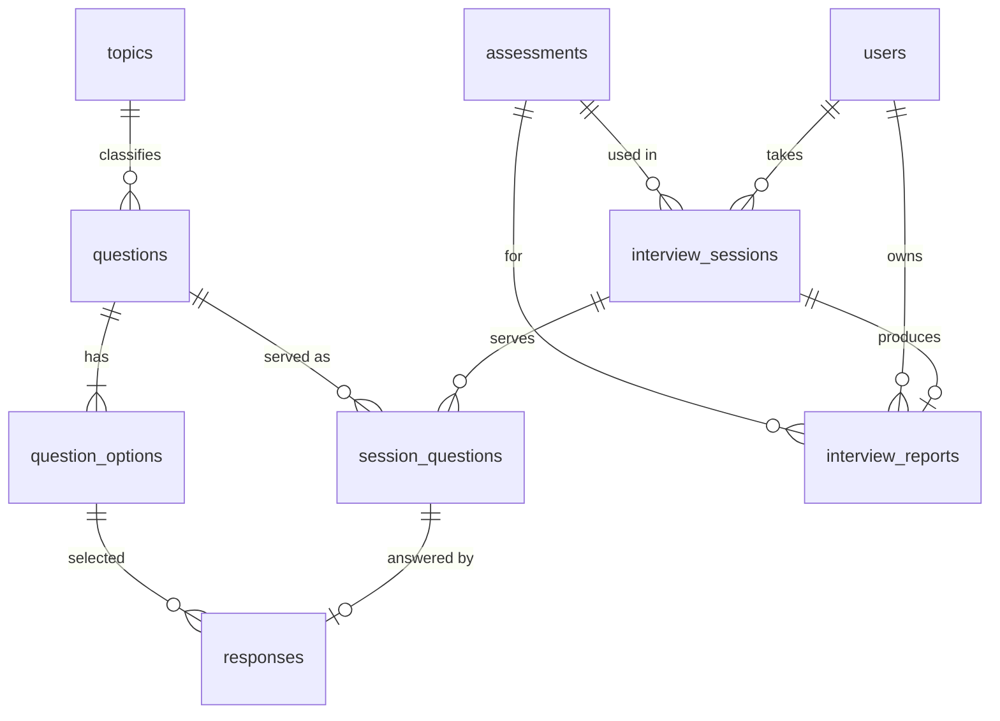

# Database

## Tables

| Table                | Purpose                                               | Notable constraints                                     |
| -------------------- | ----------------------------------------------------- | ------------------------------------------------------- |
| `users`              | Candidates and admins (`role` ENUM)                   | `email` UNIQUE                                          |
| `topics`             | Topic names                                           | `name` UNIQUE                                           |
| `questions`          | Question text, difficulty, type, active flag          | FK topic; index `(active, difficulty, question_type)`   |
| `question_options`   | Options with `is_correct`                             | FK question, ON DELETE CASCADE                          |
| `assessments`        | Title, question count, duration, `show_explanations`  |                                                         |
| `interview_sessions` | State: current difficulty, streaks, score, timestamps | index `(candidate_id, status)`                          |
| `session_questions`  | Which question was served, in what order, when        | **UNIQUE (session_id, question_id)**                    |
| `responses`          | One answer per served question                        | `session_question_id` UNIQUE (no edits)                 |
| `interview_reports`  | Stored report snapshot                                | `session_id` UNIQUE; index `(candidate_id, created_at)` |

## Design notes

- A separate `candidates`/`admins` table and `performance_metrics` table were not created: role lives on `users`, and metrics are computed from `responses` with SQL aggregates, which avoids stale duplicated data.
- Report list-like fields (topic breakdown, progression) are JSON text in `interview_reports`, a snapshot that stays stable even if questions change later.
- Used questions are never hard-deleted or have their options changed, so history stays valid.
