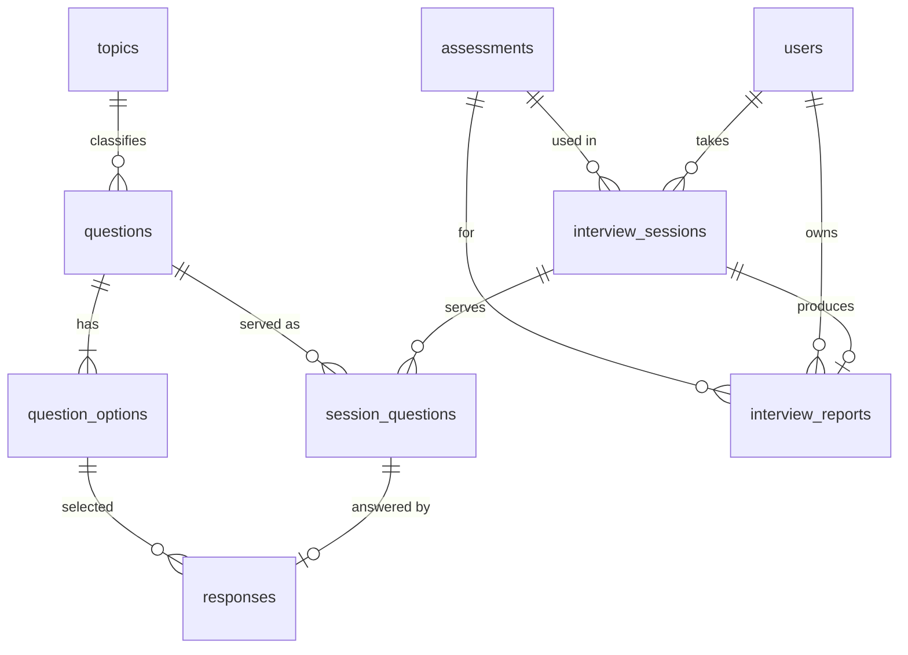

# Database

## Entity Relationship Diagram



## Tables

| Table                | Purpose                                               | Notable constraints                                     |
| -------------------- | ----------------------------------------------------- | ------------------------------------------------------- |
| `users`              | Candidates and admins (`role` ENUM)                   | `email` UNIQUE                                          |
| `topics`             | Topic names                                           | `name` UNIQUE                                           |
| `questions`          | Question text, difficulty, type, active flag          | FK topic; index `(active, difficulty, question_type)`   |
| `question_options`   | Options with `is_correct`                             | FK question, ON DELETE CASCADE                          |
| `assessments`        | Title, question count, duration, `show_explanations`  |                                                         |
| `interview_sessions` | State: current difficulty, streaks, score, timestamps | Index `(candidate_id, status)`                          |
| `session_questions`  | Which question was served, in what order, when        | UNIQUE `(session_id, question_id)`                      |
| `responses`          | One answer per served question                        | `session_question_id` UNIQUE                            |
| `interview_reports`  | Stored report snapshot                                | `session_id` UNIQUE; index `(candidate_id, created_at)` |

## Database Migrations

The database schema is managed through versioned Go migrations in the backend. The old manually imported `database/schema.sql` file is no longer used.

When the backend starts with `RUN_MIGRATIONS=true`:

1. It connects to the MySQL database.
2. It checks the `schema_migrations` table for applied migrations.
3. It applies pending migrations in order.
4. It records successfully applied migration versions.
5. It runs the seed process, if configured.

Migrations are applied only once. On subsequent starts, already-applied migrations are skipped.

### Local Setup

Create the database before starting the backend:

```bash
mysql -u root -p -e "CREATE DATABASE adaptive_assessment CHARACTER SET utf8mb4;"
```

Configure the backend environment, including `RUN_MIGRATIONS=true`, then run:

```bash
cd backend
go mod tidy
go run ./cmd/server
```

### Docker Setup

Docker Compose starts MySQL and waits for its healthcheck before starting the backend. The backend then applies pending migrations.

```bash
docker compose up -d --build
```

To rebuild the database from scratch during development:

```bash
docker compose down -v
docker compose up -d --build
```

**Warning:** `docker compose down -v` deletes the MySQL Docker volume and all data stored in it.

## Design Notes

- A separate `candidates`/`admins` table and `performance_metrics` table were not created: role lives on `users`, and metrics are computed from `responses` with SQL aggregates, which avoids stale duplicated data.
- Report list-like fields (topic breakdown, progression) are JSON text in `interview_reports`, a snapshot that stays stable even if questions change later.
- Used questions are never hard-deleted or have their options changed, so history stays valid.
